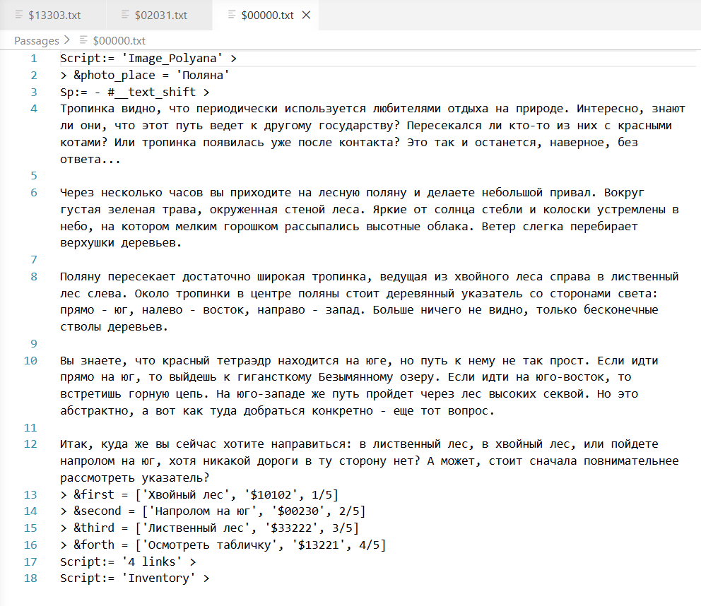
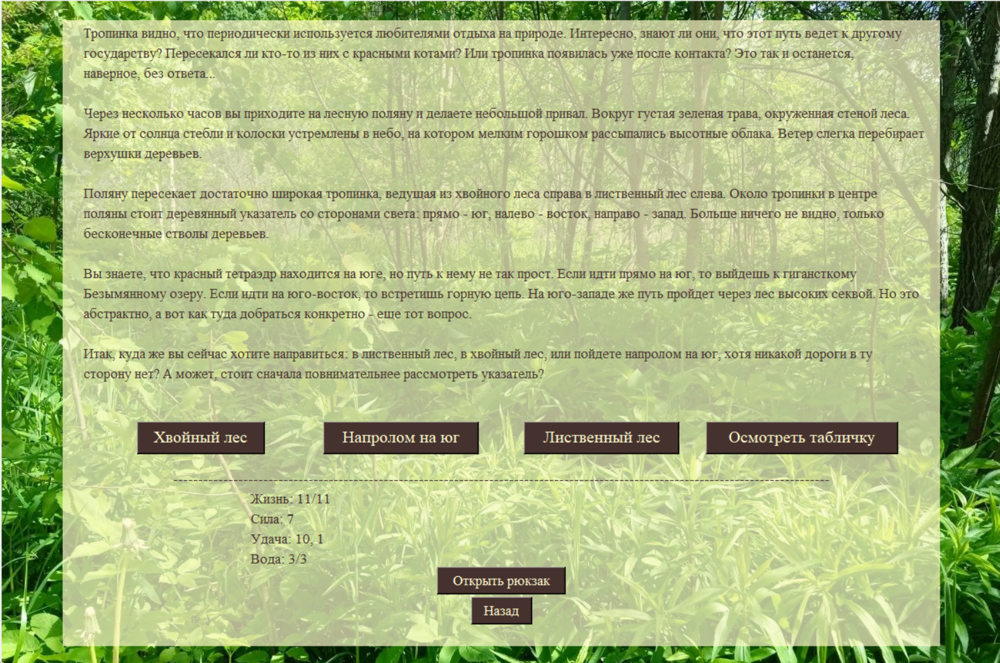

# altair_text_adventures

**Altair** — мой собственный мини-язык программирования и движок на Python для разработки текстовых квестов и визуальных новелл. Начинался он как маленький проект, чтобы упростить себе Python-разработку квеста, но со временем разросся. Сейчас ему уже около двух лет, и я периодически к нему возвращаюсь с новыми идеями

---

## Структура репозитория

*   📁 **`Altair`** — стартовый шаблон для проекта с настроенным стилем и размером окна по умолчанию.
*   📁 **`Лесной квест 0.1.2.0 приложение`** — готовый пример скомпилированного текстового квеста (в формате `.exe`) на базе плеера.

---

## Как все это выглядит внутри

  
  
<i>Рис. 1: Пример исходного кода параграфа на языке Altair</i>

  
   
  
  
  
<i>Рис. 2: Готовый параграф, который генерируется из кода выше</i>

  
   
  
  
  
<i>Рис. 3: Отображение кода в кастомном редакторе Altair (что я написал сам)</i>

---

## Устройство языка

Папка с движком разделена на интерпретатор («проигрыватель») и текстовые файлы с кодом игры:

1.  **Интерпретатор:** Запуск квестов осуществляется через файл `Player.py`.
2.  **Конфигурация:** 
    *   `Architecture.txt` — задает размер окна.
    *   `Stylesheet.txt` — отвечает за стилизацию и внешний вид.
3.  **Игровой процесс:** Стартовым параграфом всегда является параграф `Start.txt`. Из него игрок перемещается по другим параграфам (`Passages`) и вызывает подпрограммы (`Scripts`).

> **Скрипты (Папка `Scripts`):** Это полноценные программы на языке Altair. Их можно динамически вызывать внутри любых параграфов и других скриптов.

---

## Что можно в версии 2.2.0

*   Выводить текст и вставлять изображения
*   Создавать кнопки и переходы между параграфами/сценами
*   Работать с глобальными и локальными переменными
*   Вызывать подпрограммы (скрипты) - аналог функций
*   Настраивать стиль и размер окна через конфигурационные файлы
*   Делать шаг назад и создавать закладки (пока только в рамках одной игровой сессии)

---

## Планы на будущее

*   [ ] Выпустить полноценный мануал когда язык будет финально отредактирован ^0_-_0^
